## Tentang saya

Saya mahasiswa Teknik Informatika di Universitas Trunojoyo Madura yang tertarik pada pengembangan web, jaringan komputer, dan teknologi secara umum. Saya terbiasa membangun aplikasi web dari backend sampai antarmuka (PHP, Laravel, Python, JavaScript) dan mengintegrasikan AI ke dalam produk. Saya senang belajar hal baru dan bekerja dalam tim.

- Kuliah S1 Teknik Informatika, Universitas Trunojoyo Madura (2024 – sekarang)
- Anggota UKM Triple-C (Creative Computer Club)
- Sedang mendalami Flutter dan pengembangan web full stack

## Prestasi dan sertifikasi

**Prestasi**
- 10 Besar Kompetisi Web Development, FTI Festival 2026, dengan proyek CodingGo

**Sertifikat**
- Apps Development with Flutter (9 modul), MySkill, Oktober 2026
- Frontend – Project Portfolio (2 modul), MySkill, Oktober 2026
- Intro to Software Engineering (Coding Camp), RevoU, September 2026
- DSF 54.0 – FWD, FE & BE, Dibimbing, September 2026
- Website Development: Back End, MySkill, Agustus 2026
- Building Website with Lovable AI, MySkill, Agustus 2026

## Proyek pilihan

| Proyek | Teknologi | Deskripsi |
|---|---|---|
| [**CodingGo**](https://coding-go.freedev.app) | PHP, JavaScript | Platform belajar coding (HTML, CSS, JavaScript, Python) dengan fitur AI Review yang meninjau kode peserta secara otomatis. 10 besar FTI Festival 2026. |
| [**Website UKM Triple-C**](https://web-ukm-triple-c-remake.onrender.com) | JavaScript, Google Gemini API | Website resmi UKM Triple-C dengan AI Assistant yang menjawab pertanyaan peserta lomba. |
| [**SahamSearch**](https://search-engine-berita-saham.onrender.com) | PHP, Laravel, Python, JSON | Mesin pencari berita saham dan pasar modal dengan pengurutan hasil memakai algoritma BM25. |
| **Jaya Material** | PHP, Laravel | E-commerce bahan bangunan dengan pencarian produk, kategori, kalkulator estimasi material, dan keranjang belanja. |
| **Mahreen Indonesia** | HTML, CSS, JavaScript | Platform kreativitas, teknologi, dan kolaborasi generasi muda untuk menemukan program dan peluang. |
| **Terakota Coffee & Eatery** | HTML, CSS, JavaScript | Menu digital kafe dengan keranjang pesanan, pemesanan lewat WhatsApp, serta mode gelap dan terang. |
| **MovieFlix** | JavaScript, Vite | Penjelajah film dan serial bergaya streaming dengan pencarian judul dan halaman info lengkap. |
| **Laguku** | Android, Web | Landing page aplikasi pemutar musik Android bebas iklan: unduh APK, fitur, panduan install, changelog, dan FAQ. |

Daftar lengkap ada di tab [Repositories](https://github.com/Rafie110905?tab=repositories).

## Skill

| Kategori | Teknologi |
|---|---|
| Frontend | `HTML` `CSS` `JavaScript` `TypeScript` `React` `Tailwind CSS` `Astro` |
| Backend & Database | `PHP` `Laravel` `CodeIgniter 3` `Python` `Node.js` `MySQL` `SQLite` |
| Mobile | `Dart` `Flutter` |
| AI & Tools | `Google Gemini API` `Git` `GitHub` `Docker` `Figma` `Postman` `Microsoft Office` |

## Aktivitas GitHub

 

## Terhubung

- LinkedIn: [moh-rafie-nazar-jailani](https://www.linkedin.com/in/moh-rafie-nazar-jailani)
- GitHub: [Rafie110905](https://github.com/Rafie110905)
- Email: [mohrafienazarjailani@gmail.com](mailto:mohrafienazarjailani@gmail.com)

